# DisketeBoy 💾

**Apunta tus videojuegos, juegos de mesa y cartas en una consola retro y míralos amontonarse en tu habitación 3D.**

<p>
  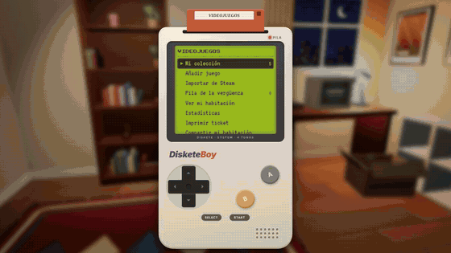
</p>

▶️ Vídeo de 25 s para Reddit: [en inglés](docs/video/disketeboy-en.mp4) · [en español](docs/video/disketeboy-es.mp4). Se vuelve a grabar con `node disketeboy/tools/video.mjs` (o `… es`).

<p>
  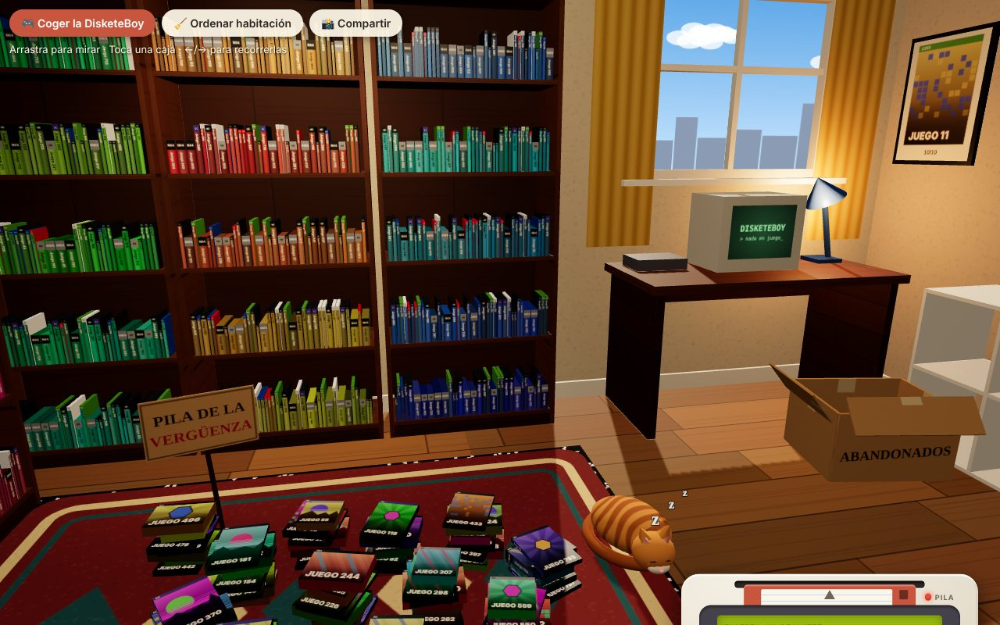
</p>
<p>
  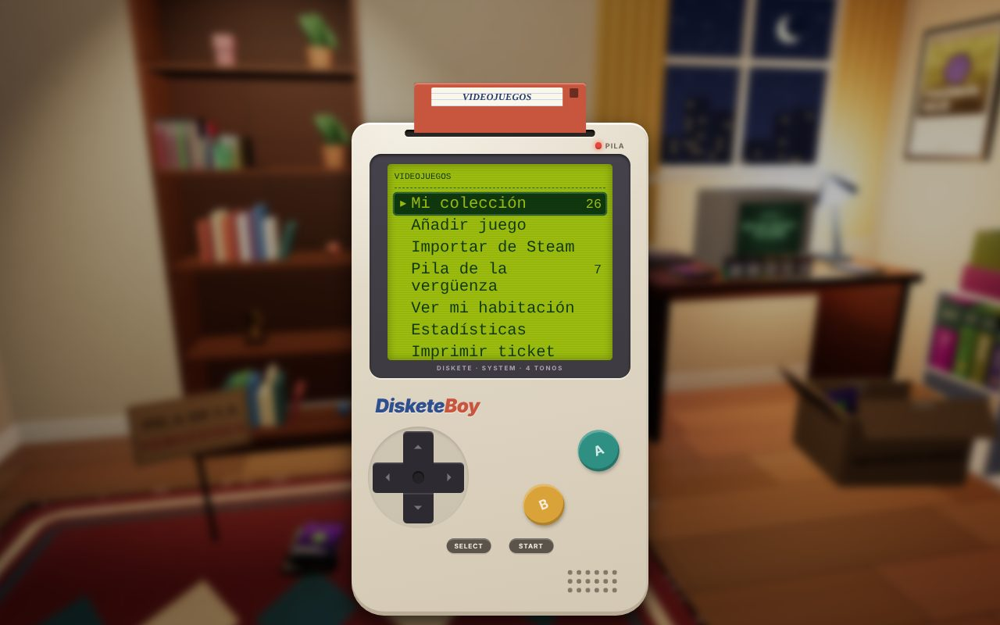
  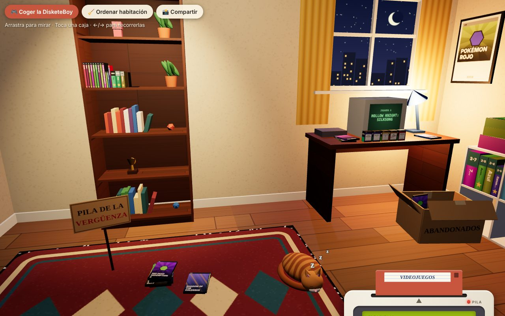
</p>
<p>
  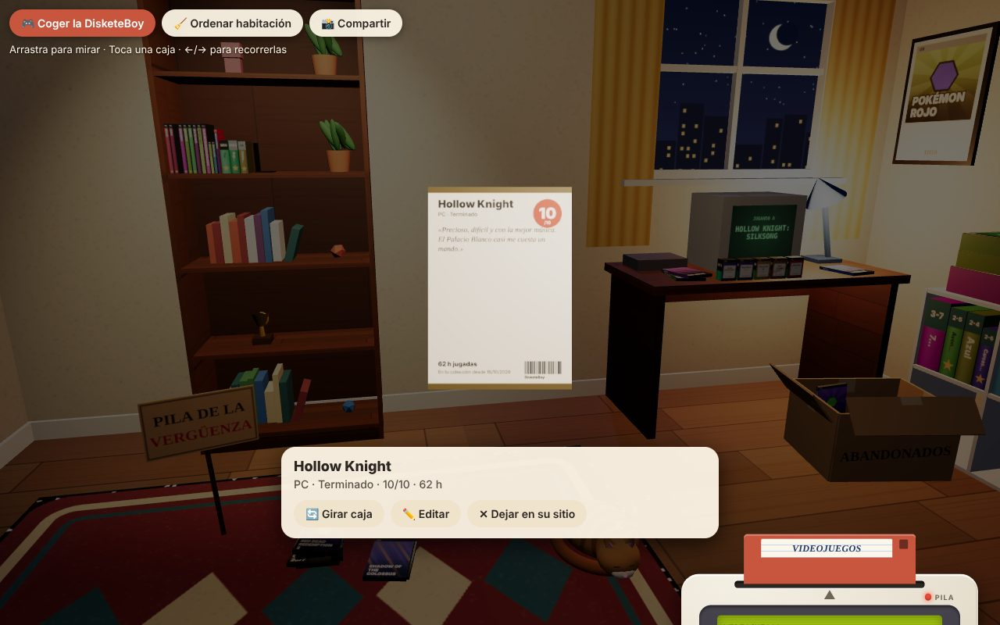
  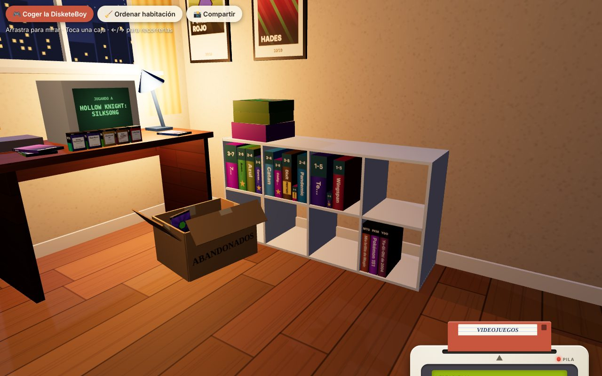
</p>
<p>
  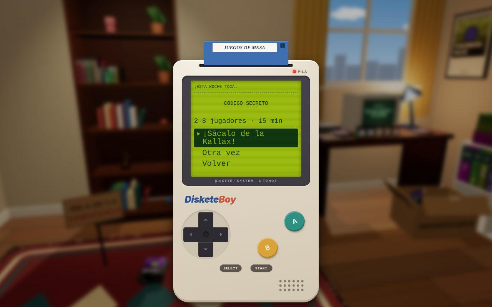
  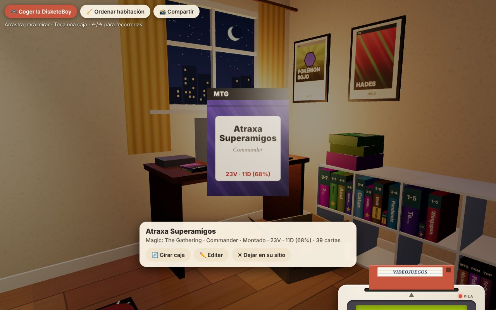
  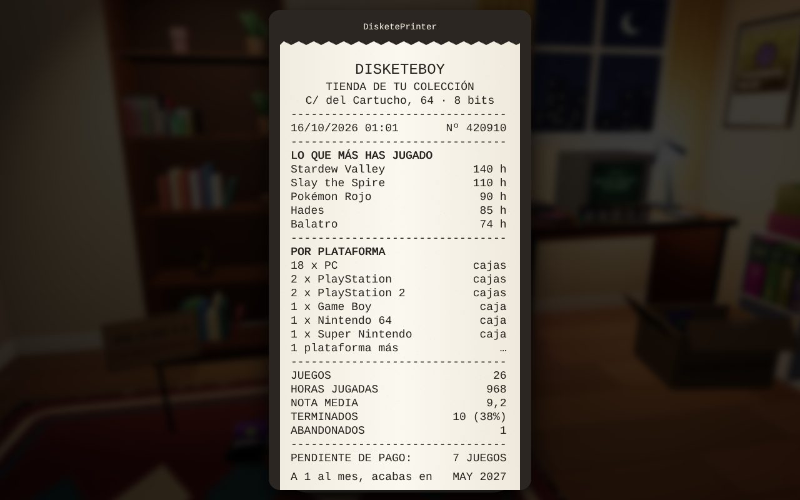
</p>
<p>
  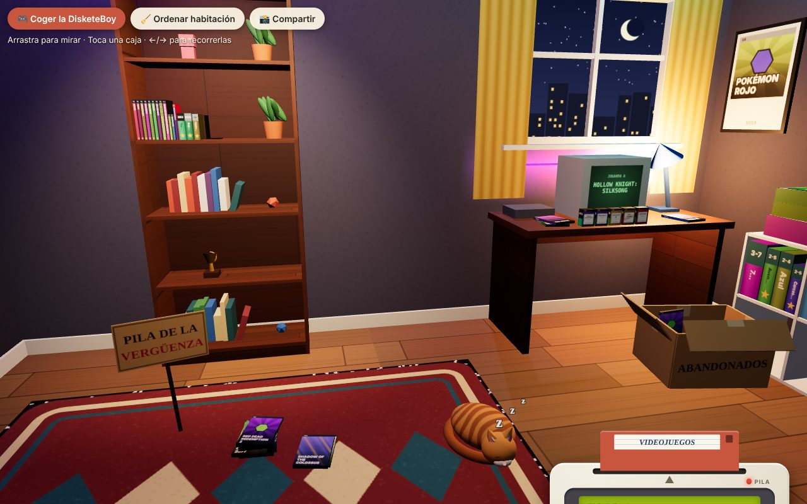
  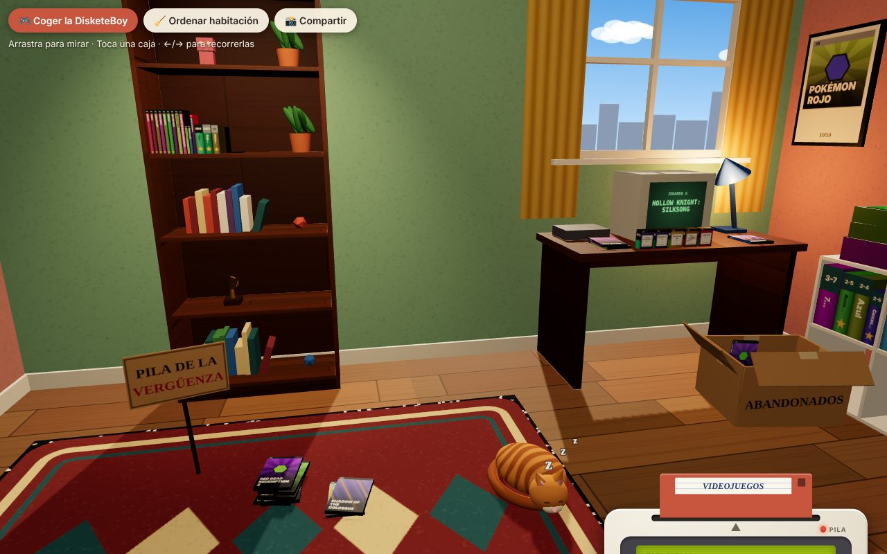
  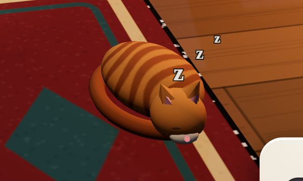
</p>
<p>
  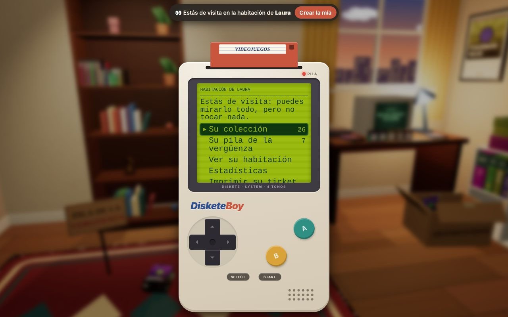
  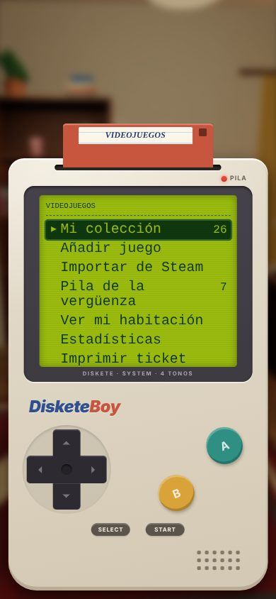
  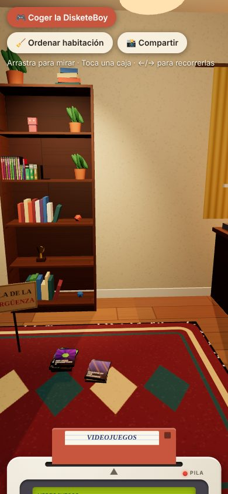
</p>

Gestionas la colección desde la DisketeBoy, una consola de diseño propio con un disquete por colección. Detrás está tu habitación, y cada juego aparece en ella según su estado:

| Estado | Dónde acaba la caja |
|---|---|
| Pendiente | En la **pila de la vergüenza**, en el suelo |
| Jugando | En el **escritorio**, junto a la tele de tubo, que muestra a qué juegas |
| Jugado / Terminado | En la **estantería**, con el lomo hacia fuera (★ si lo has terminado) |
| Abandonado | En la **caja de cartón de ABANDONADOS** |

Coges una caja, la giras y **en la contraportada está tu reseña**, con tu nota y tus horas.

**Disquete de juegos de mesa**: tus juegos de mesa en una Kallax, con el número de jugadores en el lomo. Los sin estrenar van encima con su plástico, y los prestados llevan un pósit: «Lo tiene Pedro desde hace 143 días». Con **«¿Qué jugamos esta noche?»** dices cuántos sois y cuánto tiempo tenéis, una ruleta elige y la caja sale volando de la Kallax. Tu colección de **BoardGameGeek** se importa de una vez: lo que no tiene partidas va encima, aún con su plástico.

**Disquete de cartas**, para cualquier juego de cartas: los **mazos** son cajitas delante de la tele, con su récord («23V · 11D (68%)») y la lista, que cuenta las cartas sola. Las **carpetas** van a los cubos de abajo de la Kallax, con el número de cartas y el valor estimado. Ambos se rellenan solos con el CSV que exportan ManaBox, Dragon Shield o Delver Lens.

**«Compartir mi habitación»** crea un enlace con tu colección comprimida dentro, sin cuentas ni servidor. Quien lo abre ve tu habitación de visita, sin tocar la suya.

**En español y en inglés**: sale en el idioma del navegador y se cambia en Ajustes → Idioma (o con `?lang=en` en la dirección). Se traduce todo: la consola, los carteles de la habitación, las portadas, el ticket e incluso las reseñas de la demo.

**Tu habitación, a tu gusto**: en Ajustes eliges el tema (*Crema*, *Gamer RGB* con tira LED o *Retro 90*) y si quieres al gato, que duerme en la alfombra y ronronea si lo tocas. El tema y el gato viajan en el enlace de visita. Están pensados como futuras ventajas para mecenas; ahora son gratis para todos.

> Prototipo en desarrollo. Está en esta carpeta para no mezclarlo con retorika Home; cuando guste, se pasa a su propio repositorio.

## Arrancar

```bash
node disketeboy/server.mjs                      # http://localhost:5180
# con importación real de Steam (clave gratis en https://steamcommunity.com/dev/apikey):
STEAM_API_KEY=xxxx node disketeboy/server.mjs
# si BoardGameGeek pide clave para su API (registro de aplicaciones):
BGG_TOKEN=xxxx node disketeboy/server.mjs
```

| | URL |
|---|---|
| Con la colección de demo | http://localhost:5180/?demo=1 |
| Probar otra hora (día, tarde, noche) | añade `&hora=12`, `&hora=20` o `&hora=23` |
| Solo la consola, sin 3D | añade `&sin3d=1` |
| En inglés | añade `&lang=en` |

En Netlify se sirve en `/disketeboy/`, con sus funciones en `netlify/functions/disketeboy-*.mjs`.

**Antes de publicar**: pon tu página de Ko-fi (o similar) en `js/config.js`, y la dirección completa de `og.jpg` en la etiqueta `og:image` de `index.html`. El resto de la lista está en [docs/LANZAMIENTO.md](docs/LANZAMIENTO.md).

## Controles

- **Consola:** cruceta o flechas, **A** o Enter para aceptar, **B** o Escape para volver. **SELECT** baja la consola para ver la habitación y **START** vuelve al menú. También funciona con ratón, con el dedo y con lector de pantalla.
- **Habitación:**
  - Arrastra para mirar alrededor y usa la rueda o pellizca para acercarte.
  - Toca una caja para cogerla y vuelve a tocarla para darle la vuelta.
  - Con el teclado, ← y → recorren las cajas.

## Cómo está hecho

- Sin frameworks ni paso de compilación: HTML, CSS y módulos JS. Lo único de fuera es [three.js](https://threejs.org) (MIT), copiado en `vendor/three`.
- **Todo lo que se ve está hecho con código**: muebles con geometría simple y portadas, lomos, alfombra, cielo y ventana pintados en canvas. Nada de dibujos con IA ni assets ajenos. Las portadas reales de Steam son de sus autores.
- La habitación **solo se redibuja cuando algo se mueve**, para no gastar batería.
- La colección se guarda en el navegador (`localStorage`) y se valida al leerla. Se puede exportar e importar como copia de seguridad.
- **Se instala como una app** en el móvil y en el ordenador («Añadir a pantalla de inicio»), con su icono de disquete (`manifest.webmanifest` e `icons/`).

| Archivo | Qué hace |
|---|---|
| `js/device.js` | La consola: pantallas, cruceta, teclado |
| `js/room.js` | La habitación 3D, las animaciones y coger cajas |
| `js/layout.js` | Dónde va cada caja (funciones puras, con tests) |
| `js/covers.js` | Portadas, lomos y contraportadas en canvas |
| `js/store.js` | La colección guardada y validada |
| `js/ticket.js` | DisketePrinter: el ticket y la foto para compartir |
| `js/boards.js` | Juegos de mesa: «¿Qué jugamos esta noche?», préstamos (funciones puras) |
| `js/cards.js` | Cartas: juegos de cartas, contar la lista de un mazo, récord y estadísticas (funciones puras) |
| `js/share.js` | «Visita mi habitación»: la colección comprimida en el enlace |
| `js/config.js` | Lo que se cambia a mano antes de publicar: el enlace de donaciones |
| `js/i18n.js` | Idiomas: `t('texto en español')` lo traduce con el diccionario |
| `js/lang/en.js` | El diccionario inglés (una prueba vigila que no falte ni sobre nada) |
| `tools/video.mjs` | Graba el vídeo promocional fotograma a fotograma |
| `api/steam.mjs` | Lee tu biblioteca pública de Steam |
| `api/cover.mjs` | Plan B para las portadas de Steam (solo admite ids numéricos) |
| `api/bgg.mjs` | Lee tu colección de BoardGameGeek (lo que tienes, sin expansiones) |

## Pruebas

```bash
npm ci                                        # en la raíz: Playwright y axe-core
node --test disketeboy/tests/unit/*.test.mjs  # 70 pruebas unitarias
node disketeboy/tests/e2e/run.mjs             # 25 pruebas en Chromium (E2E_SHOTS=1 guarda capturas)
```

En GitHub se ejecutan solas con `.github/workflows/disketeboy.yml` cada vez que cambia algo en `disketeboy/`.

Lo que se ha hecho cada noche está en [docs/DIARIO-NOCHE.md](docs/DIARIO-NOCHE.md), el plan para sacarlo a Reddit, en [docs/LANZAMIENTO.md](docs/LANZAMIENTO.md), y los posts listos para pegar, en [docs/POSTS.md](docs/POSTS.md).
